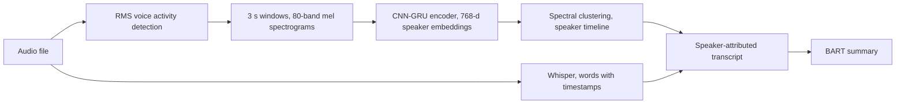
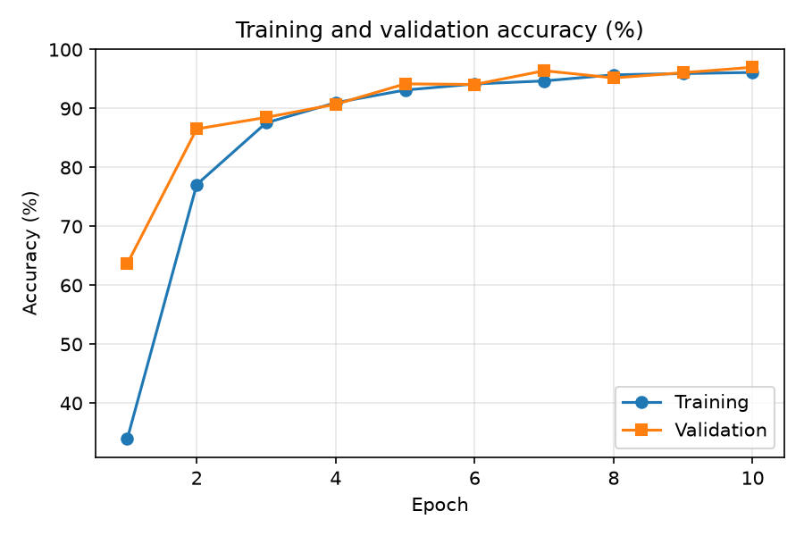

# Speaker Identification, Diarization and Summarization

Upload a recording of a conversation and get back:

- **who spoke when** – a coloured speaker timeline,
- **a transcript** with `Speaker 1:`, `Speaker 2:` … each in its own colour,
- **a summary** of the whole conversation.

The speaker model is a hybrid **CNN–GRU network trained from scratch** for this project,
following the paper *"A Hybrid CNN–GRU Architecture for Speaker Identification and
Summarization using Real-time Conversations"*. Transcription uses pre-trained OpenAI
Whisper and summarisation uses a pre-trained BART model. Everything runs locally; no audio
leaves the machine.



## Results

| Metric | Paper | This repository |
|---|---|---|
| Training accuracy (251 speakers) | ≈ 95 % | 96.1 % |
| Validation accuracy | 91.57 % | 97.0 % |
| Held-out test accuracy | – | 96.9 % |
| Speaker-verification EER (16.4 M pairs) | 5.96 % | 6.04 % |
| EER on speakers never seen in training (dev-clean) | – | 8.82 % |

Diarization on test conversations built from unseen speakers (`samples/`):

| Conversation | Speakers found / true | Speaker confusion | Total DER |
|---|---|---|---|
| 1 speaker | 1 / 1 | 0 % | 15.7 % |
| 2 speakers (three files) | 2 / 2 | 0 % | 6.6 – 19.8 % |
| 3 speakers | 3 / 3 | 0 % | 15.1 % |
| 3 speakers, noisy | 3 / 3 | 0.5 % | 14.5 % |
| 4 speakers, noisy | 3 / 4 | 15.7 % | 25.6 % |
| 5 speakers | 5 / 5 | 0 % | 14.1 % |

Most of the DER is "missed speech": short pauses inside sentences that the energy-based VAD
treats as silence. Training curves and FAR/FRR plots are in [`reports/`](reports).



## Quick start

Tested on Windows 11 with Python 3.14 and an NVIDIA RTX 4060 (8 GB). A GPU is recommended
but not required – on CPU everything works, only slower.

**1. Clone**

```bash
git clone https://github.com/vinu2912/Speaker-identification-and-diarization.git
cd Speaker-identification-and-diarization
```

**2. Create a virtual environment**

```bash
python -m venv .venv
```

Activate it – Windows:

```bash
.venv\Scripts\activate
```

Linux / macOS:

```bash
source .venv/bin/activate
```

**3. Install PyTorch**

With an NVIDIA GPU (CUDA 12.8 build):

```bash
pip install torch --index-url https://download.pytorch.org/whl/cu128
```

Without a GPU:

```bash
pip install torch
```

**4. Install the other packages**

```bash
pip install -r requirements.txt
```

**5. Run the app**

```bash
python app.py
```

Open <http://127.0.0.1:8000>, drop in an audio file and press **Analyse recording**.
On Windows you can also double-click `run_app.bat`.

The trained speaker model is included (`checkpoints/cnn_gru_best.pt`), so no training is
needed to use the app. The **first run downloads Whisper and BART (about 3 GB)** from
Hugging Face; after that the app works offline.

**Try it immediately** with the bundled clips `samples/conversation_2spk.wav` and
`samples/conversation_3spk.mp3`.

### Using the app

- Accepts WAV, MP3, M4A, FLAC, OGG and video files (decoded with PyAV – no ffmpeg install).
- **Number of speakers:** leave on *Detect automatically*, or set it if you know it.
- Click any transcript line or the timeline to jump the audio to that point.
- Long recordings get a part-by-part summary with timestamps below the overview.
- **Download .txt** saves the transcript and summary.

## Project structure

```
├── app.py                 Web server (FastAPI): upload, progress, results
├── train.py               Trains the CNN–GRU speaker encoder
├── evaluate.py            EER and diarization-error evaluation
├── run_app.bat            Windows launcher for the app
├── requirements.txt
├── sid/                   The speaker-identification package
│   ├── config.py          All settings in one place
│   ├── audio.py           Decode any audio/video file to 16 kHz mono
│   ├── features.py        Log-mel spectrograms, pitch/time-stretch augmentation
│   ├── model.py           CNN–GRU architecture
│   ├── data.py            LibriSpeech loading and 80/10/10 split
│   ├── diarize.py         VAD, windowing, embeddings, voting, timeline
│   ├── clustering.py      Spectral clustering with eigengap heuristic
│   ├── transcribe.py      Whisper speech-to-text
│   ├── summarize.py       BART conversation summary
│   └── pipeline.py        Ties the stages together
├── static/index.html      The web page
├── tools/
│   ├── download_dataset.py    Fetch LibriSpeech into data/
│   ├── make_conversation.py   Build labelled multi-speaker test audio
│   └── test_api.py            Send a file to the running app from the terminal
├── checkpoints/           Trained model (cnn_gru_best.pt)
├── reports/               Training log, curves, evaluation results
└── samples/               Demo clips and ground-truth speaker turns
```

## How it works (paper Section III)

| Stage | What happens | Code |
|---|---|---|
| Pre-processing | 16 kHz mono, 3 s sliding windows, zero-mean / unit-variance | `sid/audio.py`, `sid/diarize.py` |
| Spectrogram | 80 mel bands (0–8 kHz), 512-point STFT, 50 % hop, Hann window, scaled 0–1 | `sid/features.py` |
| Embedding | CNN (32→64→128 filters, 3×3, BN, ReLU, max-pool, dropout 0.3/0.4) → bidirectional GRU (256) → 768-d `tanh` embedding. The 251-way softmax head is used only for training | `sid/model.py` |
| VAD | RMS energy, threshold 0.02 | `sid/diarize.py` |
| Clustering | Spectral clustering: cosine affinity, row normalisation, graph Laplacian, eigengap heuristic, k-means | `sid/clustering.py` |
| Timeline | Majority voting over overlapping windows, 0.5 s minimum segment, merge | `sid/diarize.py` |
| Transcript | OpenAI Whisper (`large-v3-turbo`) with word timestamps, matched to the speaker timeline | `sid/transcribe.py`, `sid/pipeline.py` |
| Summary | Dialogue-summarisation BART (`philschmid/bart-large-cnn-samsum`) | `sid/summarize.py` |

## Training from scratch (optional)

Download LibriSpeech `train-clean-100` (6.3 GB) and `dev-clean` (0.3 GB):

```bash
python tools/download_dataset.py
```

Train (about 45 minutes on an RTX 4060):

```bash
python train.py
```

Settings follow the paper (Section III-C): 251 speakers, categorical cross-entropy, Adam
(lr 0.001), batch 32, 10 epochs, L2 weight decay 0.0001, dropout 0.3–0.4, 80/10/10 split,
early stopping (patience 3), time-stretch ±10 % and pitch-shift ±2 semitones. Training writes
`checkpoints/cnn_gru_best.pt` and the curves in `reports/`.

## Evaluation (optional)

```bash
python evaluate.py
```

Computes the speaker-verification EER from pairwise cosine similarity (as in the paper's
Section V-A) and the diarization error on the labelled conversations in `samples/`. Results
go to `reports/evaluation.json`. Only two demo clips are stored in the repository; the
commands that recreate the full eight-file test set are listed at the top of
`tools/make_conversation.py`.

## Where this differs from the paper

- **Batch-norm recalibration.** Before each validation the batch-norm running statistics
  are recomputed on clean audio with dropout off. Without it, validation accuracy was far
  below training accuracy. Architecture and hyper-parameters are unchanged.
- **Inference windows follow pauses.** The 3 s windows slide (0.5 s hop) inside each
  stretch of speech found by the VAD, instead of over the raw file, so fewer windows
  straddle two speakers.
- **VAD loudness normalisation.** The recording level is normalised before the 0.02 RMS
  threshold is applied, so quiet recordings are not rejected as silence.
- **Speaker-count refinements.** After the eigengap estimate, clusters whose centroids are
  the same voice (cosine > 0.87) are merged, and each window keeps at most 80 neighbours in
  the affinity matrix so long multi-speaker recordings are not collapsed into two speakers.
- **Spectrogram size.** 512-point STFT with 50 % hop gives 80 × 188 frames per 3 s window
  (the paper quotes 80 × 94).
- **Whisper and summarisation** were future work in the paper; they are implemented here.
  Long recordings are summarised part by part (time-stamped), with an overview built from
  the lead sentence of every part so later topics are not dropped.

## Known limitations

The encoder is trained only on clean, read, single-speaker LibriSpeech audio, so – as the
paper also reports – it is strongest on clean recordings with clear turn-taking.

- **Crowded, fast discussions are under-counted.** On a real 42-minute meeting with about
  six participants it separated four voices; on a 7-minute group discussion with seven to
  eight people it found three. Brief or similar-sounding speakers get merged.
- **Overlapping speech** is not handled.
- **Summaries** are abstractive and can misstate a detail, especially when two people were
  merged into one speaker label. The summariser is English-only.
- **Proper nouns** (product and company names) are sometimes misheard by Whisper.

The natural next step is training on conversational data such as the AMI meeting corpus.

## Troubleshooting

- **"An Application Control policy has blocked this file" (Windows 11).** Smart App Control
  blocks the unsigned DLLs shipped with PyTorch and other packages. It has to be turned off
  in Windows Security → App & browser control for the app to run.
- **No GPU detected.** The app falls back to CPU automatically; expect transcription to be
  several times slower.
- **"The CNN-GRU model has not been trained yet".** `checkpoints/cnn_gru_best.pt` is
  missing – pull it again or run `python train.py`.
- **Port 8000 already in use.** Change the port at the bottom of `app.py`.

## Credits

- [LibriSpeech](https://www.openslr.org/12) (CC BY 4.0) – training data and the audio in
  `samples/`.
- [OpenAI Whisper](https://github.com/openai/whisper) via
  [faster-whisper](https://github.com/SYSTRAN/faster-whisper).
- [`philschmid/bart-large-cnn-samsum`](https://huggingface.co/philschmid/bart-large-cnn-samsum)
  for summarisation.
